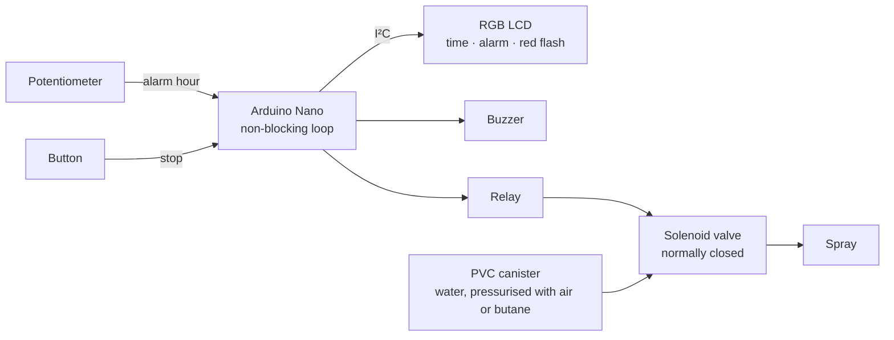

# AquAlarm

**An alarm clock that sprays water in your face if you don't wake up.** 
An Arduino alarm with an RGB LCD, a buzzer and a pressurised water canister behind a solenoid
valve, built in 24 hours at NUS Hack&Roll 2019 by a team from the Victoria Robotics and Makers
Club (VRMC), representing Victoria Junior College.

> [!NOTE]
> This consolidated README page was added by
> [Claude Opus 5.5](https://docs.anthropic.com/en/docs/claude-code) in Nov 2026 using my
> [agentic-repo-analysis](https://github.com/sp4ce-cowboy/agentic-workflows) skill, from the
> project's code and the earlier README. The project itself is from Jan 2019. The original README
> is in **[README-ORIGINAL.md](README-ORIGINAL.md)**.

## At a glance

| | |
|---|---|
| **What** | A three-stage alarm: a buzzer, then a flashing red display, then a spray of water as a last resort. A button silences it |
| **Context** | [Hack&Roll 2019](https://hacknroll.nushackers.org/), NUS Hackers' 24-hour hackathon (Jan 2019), as a team from the [Victoria Robotics and Makers Club (VRMC)](https://vrmc.github.io/index.html), representing Victoria Junior College |
| **Stack** | Arduino Nano in C++, Grove RGB LCD over I²C, the Arduino Time library, a relay, a solenoid valve, LiPo batteries, a PVC pressure canister |

 

## How it works

- **Pneumatics:** a PVC canister of water is pressurised through a Schrader or lighter valve and
  piped through pressure-rated polyurethane tubing to a normally closed solenoid valve.
- **Electromechanics:** the Arduino drives a DC relay that switches LiPo power to the valve. When
  it opens, the pressure difference pushes the water out.
- **Software** ([`aqualarm.ino`](https://github.com/sp4ce-cowboy/AquAlarm/blob/3f913a15c633db5e371671e2fa2705ea65837a0e/aqualarm/aqualarm.ino)):
  - The potentiometer sets the alarm hour (`analogRead` mapped to 0 – 24).
  - The LCD shows the time and the alarm, refreshed once a second.
  - At the alarm time, the buzzer sounds and the backlight flashes red every other second; ten
    seconds in, it moves to the spray stage, which drives the relay pin.
  - All timing uses `millis()` intervals rather than `delay()`, so the button is read on every
    pass of the loop.

## Skills shown

| Skill | Where it shows (click the links for the code) | Docs |
|---|---|---|
| **Embedded programming**  | A non-blocking loop with `millis()` timers, analogue input mapping and digital outputs: [`loop`, `alarm`](https://github.com/sp4ce-cowboy/AquAlarm/blob/3f913a15c633db5e371671e2fa2705ea65837a0e/aqualarm/aqualarm.ino#L35-L111) | [millis()](https://docs.arduino.cc/language-reference/en/functions/time/millis/) |
| **I²C peripherals** | The Grove RGB LCD: text and backlight colour: [`printPerSec`](https://github.com/sp4ce-cowboy/AquAlarm/blob/3f913a15c633db5e371671e2fa2705ea65837a0e/aqualarm/aqualarm.ino#L112-L121) | [Grove LCD](https://wiki.seeedstudio.com/Grove-LCD_RGB_Backlight/) |
| **Electromechanics** | A relay switching a solenoid valve on battery power | |
| **Pneumatics** | A pressurised canister, valves and tubing | |
| **Rapid prototyping** | Hardware and software from scratch in 24 hours | |

The `Grove_LCD_RGB_Backlight-master` and `Time-master` folders are the vendored libraries by Seeed
Studio and Paul Stoffregen, not our code.

## On our resumes

**Skills:** Arduino · embedded C++ · I²C · relays and solenoid valves · pneumatics · rapid prototyping

- Built an alarm clock in a 24-hour hackathon (Hack&Roll 2019) that escalates from a buzzer to a flashing display to a spray of water, with an Arduino Nano, a relay-driven solenoid valve and a pressurised PVC canister.
- Wrote the firmware as a non-blocking loop with `millis()` timers, so the button stays responsive while the clock, display, buzzer and valve run on separate intervals.
- Drove a Grove RGB LCD over I²C for the clock, the alarm time and a flashing red alert, with the alarm hour set by a potentiometer.
